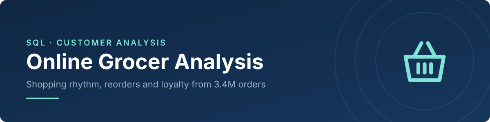
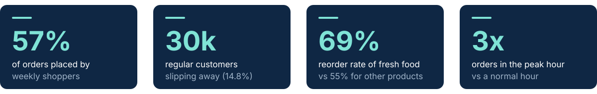
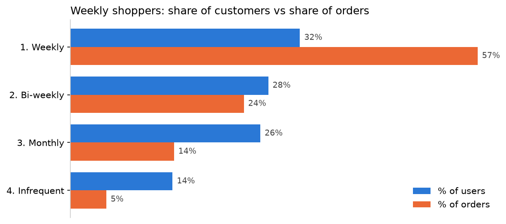
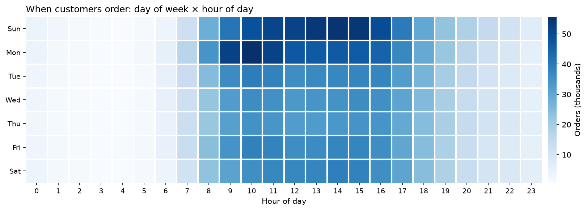
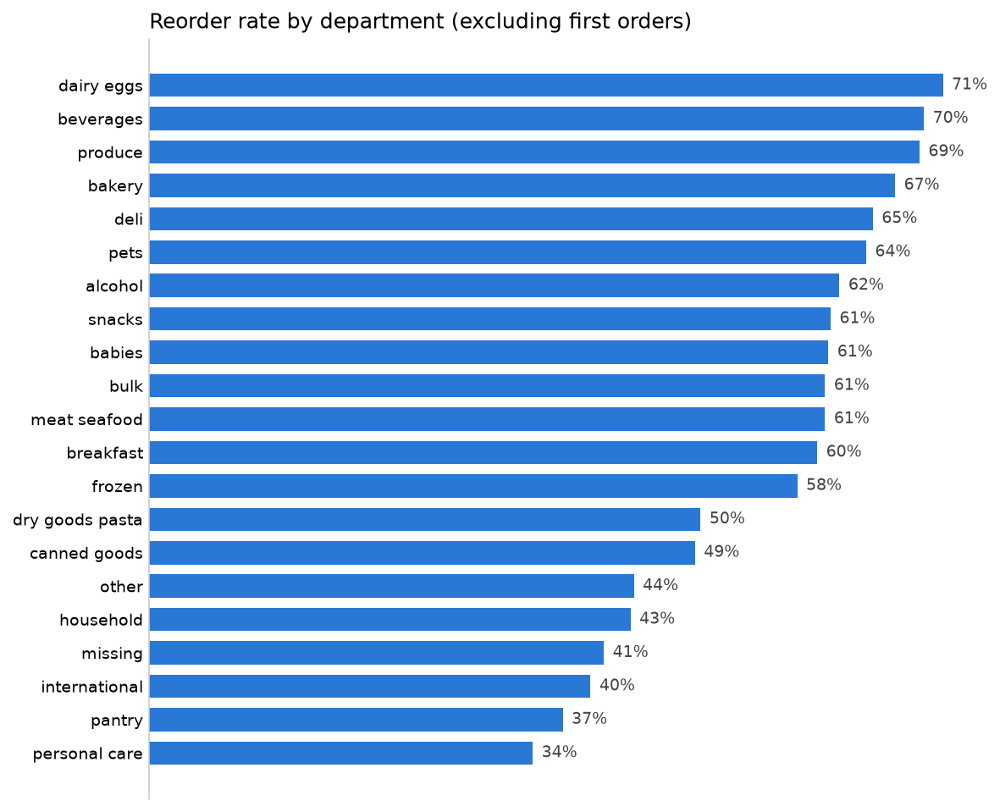
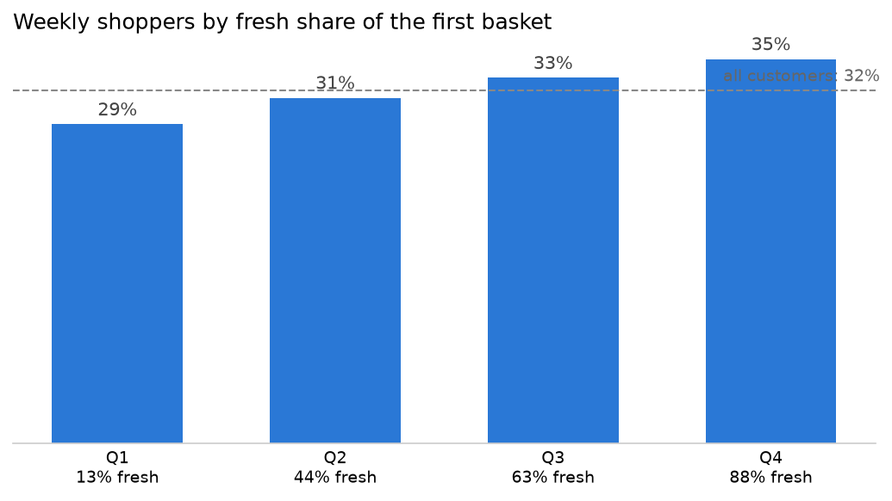

[](images/banner.svg)


[Background](#project-background) · [Key Metrics](#key-metrics) · [Summary](#executive-summary) · [Insights](#insights-deep-dive) · [Recommendations](#recommendations) · [Repository](#repository-and-how-to-run)

> SQL analysis of **3.4M orders** from **206k customers** of an online grocer. Weekly shoppers are **32% of customers but place 57% of orders**, **30k regular customers** show signs of slipping away, and fresh food is both the largest share of the basket (**55%**) and the most predictable demand (**69% reorder rate**).

<a id="project-background"></a>
[](images/h_background.svg)

An online grocer that delivers in fixed time slots lives on **repeat business**: the same customers ordering on the same routes, week after week. Knowing when customers order, how often they come back and what they buy again is what drives capacity planning, stock buying and retention.

This project answers five business questions with SQL on a public dataset of 3.4M anonymised grocery orders:

1. When do customers place orders, and how concentrated is demand?
2. How often do customers come back, and who is slipping away?
3. Which products and departments are bought again and again?
4. What is in the first basket of customers who become loyal?
5. Which data traps would bias these answers if ignored?

<a id="key-metrics"></a>
[](images/h_metrics.svg)

[](images/kpi_cards.svg)

<a id="executive-summary"></a>
[](images/h_summary.svg)

[](figures/rhythm_segments.png)

| Customer segment | Median gap between orders | % of customers | % of orders |
|---|---|---|---|
| **Weekly** | **≤ 8 days** | **31.9%** | **56.6%** |
| Bi-weekly | 9–15 days | 27.5% | 24.1% |
| Monthly | 16–29 days | 26.4% | 14.4% |
| *Infrequent* | *30+ days* | *14.2%* | *5.0%* |

*Segments are based on each customer's median gap between orders. The data caps gaps at 30 days, so 30 means "30 days or more".*

**What this means**

- **Frequency is the main driver of volume.** Weekly and bi-weekly customers (59% of the base) place 81% of all orders.
- **Retention risk is concentrated where it hurts most.** 14.8% of customers had a last gap of at least twice their usual rhythm, with the highest share among bi-weekly customers (28.5%).
- **Fresh food is the most predictable demand.** It is 55% of all items and is reordered 69% of the time vs 55% for other products: the most perishable products are also the easiest to forecast.
- **The first basket is an early signal.** New customers who buy organic family items in their first order become weekly shoppers 40–44% of the time, vs 31.9% overall.

<a id="insights-deep-dive"></a>
[](images/h_insights.svg)

### 1. Demand is concentrated at the start of the week
[Notebook 02](notebooks/02_delivery_slots.ipynb)

[](figures/orders_heatmap.png)

Two days (assumed Sunday and Monday) account for **~35%** of weekly orders, and the busiest day has **41% more orders** than the quietest. **71.6%** of orders are placed between 9:00 and 17:59. The peak hour (Monday at 10:00) has **3x** the orders of a median hour, and the two peak days behave differently: Sunday peaks in the early afternoon, Monday in the morning.

### 2. Weekly shoppers drive the business
[Notebook 03](notebooks/03_shopping_rhythm.ipynb)

Weekly customers place **1.8x** their share of orders (57% of orders from 32% of customers). Infrequent customers (14%) place only 5% of orders.

### 3. One regular customer in seven is slipping away
[Notebook 03](notebooks/03_shopping_rhythm.ipynb)

| Segment | Customers | At risk | % at risk |
|---|---|---|---|
| Weekly | 65,819 | 14,340 | 21.8% |
| **Bi-weekly** | **56,756** | **16,149** | **28.5%** |
| **Total** | **206,209** | **30,489** | **14.8%** |

A customer is *at risk* when the gap before their last order is at least 2x their usual median gap and at least 14 days. Because gaps are capped at 30 days, this rule can only flag weekly and bi-weekly customers, who place 81% of orders.

### 4. Fresh food is the biggest and most predictable part of the basket
[Notebook 04](notebooks/04_reorder_behaviour.ipynb)

[](figures/reorder_by_department.png)

From the second order on, **63%** of products are repeat purchases. Dairy & eggs (**71.4%**) and produce (**69.3%**, also the largest department with 29% of items) lead the ranking; pantry, household and personal care are reordered least (34–43%). The 20 best-selling products are all fresh (19 fruit & vegetables, 1 milk), reordered 68–90% of the time. Reordered items are also added to the cart earlier than new ones (average position 7.6 vs 9.7).

### 5. Organic family items in the first basket signal a future weekly shopper
[Notebook 05](notebooks/05_anchor_products.ipynb)

[](figures/fresh_first_basket.png)

| First-basket products (1,000+ new customers each) | Organic | % becoming weekly | Lift vs 31.9% |
|---|---|---|---|
| **Top 15** | **13 of 15** | **40–44%** | **1.25–1.37** |
| *Bottom 15* | *1 of 15* | *16–27%* | *0.50–0.84* |

The organic version of a product tends to rank high and the conventional version low, while fresh items appear in both lists. The share of weekly shoppers also rises steadily with the fresh share of the first basket, from 28.8% to 34.7%. This is a correlation: organic items most likely reveal a type of customer (e.g. families) rather than create loyalty.

**Technical details**

```
6 CSV files ──► DuckDB database ──► data quality checks ──► SQL analysis (CTEs, window functions) ──► charts + findings
 (32.4M rows)    (build_db.py)       (notebook 01)            (notebooks 02–05)                        (figures/)
```

- **Data quality first:** every rule below comes from a check in notebook 01 and is applied in all later notebooks.
- **Structural NULLs:** `days_since_prior_order` is NULL only on each customer's first order; these rows are excluded from interval analysis, never filled with 0.
- **Capped values:** gaps are capped at 30 days, so 30 is read as "30 or more" and limits what the at-risk rule can detect.
- **Reorder rates:** first orders are excluded, since every product is new by definition (59% → 63%).
- **Normalisation:** time slots of different length are compared per hour, not by total orders.
- **Consistency checks:** each result is checked against a known total (e.g. segment counts = 206,209 customers; reordered items / all items = the overall reorder rate).
- **SQL techniques:** multi-table JOINs, CTEs, `CASE WHEN` segmentation, `HAVING`, window functions (`SUM() OVER ()`, `RANK()`, `NTILE()`).

<a id="recommendations"></a>
[](images/h_reco.svg)

1. **Grow frequency, not only acquisition.** Moving bi-weekly customers to a weekly habit (recurring "basics" lists, a reminder on their usual delivery day) adds orders on routes that already exist.
2. **Act on at-risk customers early.** Trigger a win-back action as soon as a regular customer's gap breaks their usual rhythm, before they reach 30+ days.
3. **Buy fresh stock from known repeat demand.** The most perishable products are also the most predictable, so this is where order data can cut waste the most. A "Buy again" section at the top of the app would also match how customers already shop.
4. **Use the first basket as an early signal and smooth the weekly peak.** Give extra onboarding attention to new customers whose first basket suggests a lower chance of becoming regular, and test small incentives on quieter days to spread demand across the week.

**Limitations:** no calendar dates, prices or demographics (orders ≠ revenue); customers with fewer than 4 orders are excluded, so real churn is higher; day-of-week labels are an assumption (0 = Sunday); the data comes from a US grocery marketplace.

<a id="repository-and-how-to-run"></a>
[](images/h_repo.svg)

```
Online_Grocer_Analysis/
├── data/raw/                        # 6 CSV files from Kaggle (not in the repo)
├── notebooks/
│   ├── 01_data_overview.ipynb       # table sizes and data quality rules
│   ├── 02_delivery_slots.ipynb      # when customers order
│   ├── 03_shopping_rhythm.ipynb     # segments and at-risk customers
│   ├── 04_reorder_behaviour.ipynb   # reorder rates by department and product
│   └── 05_anchor_products.ipynb     # first-basket signals of loyalty
├── figures/                         # charts exported by the notebooks
├── images/                          # README banners
├── build_db.py                      # loads the CSVs into a DuckDB database
├── requirements.txt
└── README.md
```

```bash
git clone https://github.com/AlessandroCucchi/Online_Grocer_Analysis.git
cd Online_Grocer_Analysis
python -m venv .venv
source .venv/bin/activate          # Windows: .venv\Scripts\activate
pip install -r requirements.txt
# download the 6 CSV files into data/raw/
python build_db.py
jupyter notebook
```

**Data:** [Instacart Market Basket Analysis](https://www.kaggle.com/c/instacart-market-basket-analysis) (Kaggle, 2017): 3,421,083 orders from 206,209 customers, 49,688 products and 32.4M order-product rows, anonymised and without calendar dates. Please check the source's terms of use before reusing the data.

## Author

**Alessandro Cucchi**

[](https://www.linkedin.com/in/YOUR-LINKEDIN)
[](https://github.com/AlessandroCucchi)
